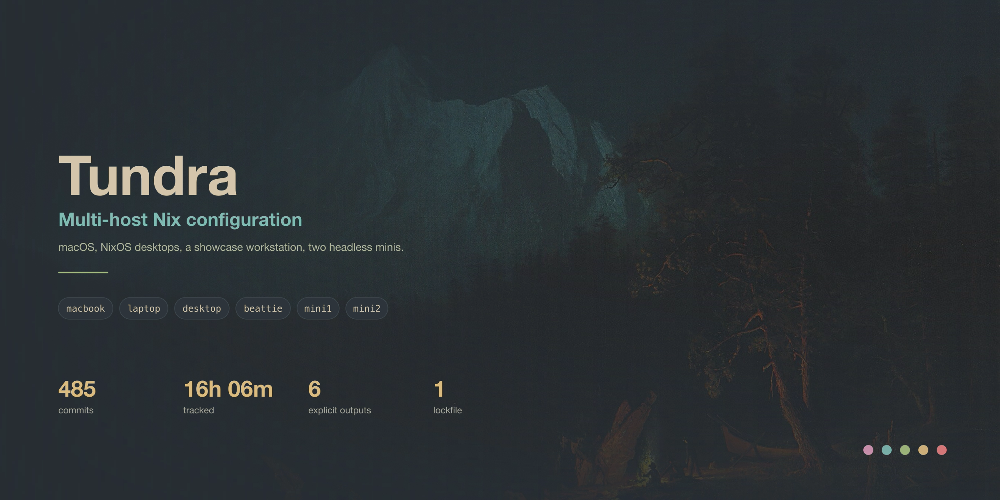

# dotfiles



[](https://codeberg.org/eliasz/dotfiles/actions)
[](LICENSE)
[](https://codeberg.org/eliasz/dotfiles)
[](https://nixos.wiki/wiki/Flakes)
[](https://github.com/nix-community/home-manager)

Single source of truth for the live macOS / NixOS system: merged Nix configuration (`hosts/` + `modules/`) plus declarative Home Manager dotfiles. Host outputs stay explicit so a build for one machine cannot be mistaken for validation of another.

Hosted primarily on **Codeberg** (`codeberg.org/eliasz/dotfiles`), mirrored to GitHub.

---

## Supported Outputs

| Role | Output | Platform | Desktop / Services |
|------|--------|----------|-------------------|
| MacBook | `darwinConfigurations.macbook` | macOS (aarch64-darwin) | AeroSpace, SketchyBar, Ghostty, Homebrew |
| Laptop | `nixosConfigurations.laptop` | NixOS (x86_64-linux) | Niri + Waybar |
| Desktop | `nixosConfigurations.desktop` | NixOS (x86_64-linux) | Mango + mangobar + Steam/gaming stack |
| Mini 1 | `nixosConfigurations.mini1` | NixOS (x86_64-linux) | Headless infrastructure |
| Mini 2 | `nixosConfigurations.mini2` | NixOS (x86_64-linux) | Headless media services |
| Mini 1 (HM fallback) | `homeConfigurations.mini1` | Home Manager only | — |
| Mini 2 (HM fallback) | `homeConfigurations.mini2` | Home Manager only | — |

See [the host inventory](docs/HOSTS.md) for architecture, ownership boundaries, hardware guidance, and rollback notes.

## Architecture & Layout

The repository is organized into modular, platform-separated layers:

```
dotfiles/
├── flake.nix              # Flake inputs & all system / Home Manager outputs
├── flake.lock             # Locked input revisions
├── hosts/                 # Host-specific NixOS / darwin configuration
│   ├── darwin/            # macBook (nix-darwin)
│   ├── desktop/           # Desktop (NixOS + Mango Wayland)
│   ├── laptop/            # Laptop (NixOS + Niri Wayland)
│   └── mini/              # Mini 1 & Mini 2 (headless NixOS)
├── modules/               # Shared & platform-specific Nix modules
│   ├── shared/            # Cross-platform Home Manager modules
│   ├── system/            # System-level NixOS settings (nix, themes)
│   ├── home/              # Home Manager-wide palette & theme options
│   ├── nixos/             # NixOS-only consumers & services
│   └── darwin/            # macOS-specific consumers
├── scripts/               # Validation & operational helpers (tundra, etc.)
├── pkgs/                  # Local Nix packages (e.g., ghostty-terminfo)
├── themes/                # SDDM & tundra theme sources
├── wallpapers/            # Desktop wallpaper collection
├── docs/                  # Operations & validation documentation
├── .github/workflows/     # GitHub Actions CI pipeline
└── DEPRECATED.md          # Deprecation ledger (purged packages & alternatives)
```

Key module directories:

- **`modules/shared/`** — Cross-platform Home Manager modules: shell, git, programs, fastfetch, orthodox, secrets, slskd, topgrade, etc.
- **`modules/system/`** — System-level NixOS settings: `nix-settings.nix` (centralized `nix.settings` + `nix.gc`), `themes.nix`.
- **`modules/home/`** — Home Manager-wide palette & theme registry (`themes.nix`).
- **`modules/nixos/`** — NixOS-only consumers & services: Mango, mangobar, fuzzel, hyprland, gaming, backup, compose stacks, etc.
- **`modules/darwin/`** — macOS-specific consumers: sketchybar, hammerspoon, karabiner, syncthing, music, terminal, themes.

---

## Core Tooling & FOSS Stack

The configuration prioritizes actively maintained, high-performance Free and Open Source Software. Key components:

| Category | Tools |
|----------|-------|
| Shell | `zsh`, `atuin` (history sync), `starship` (prompt), `zoxide` (smart `cd`), `fzf` |
| File & navigation | `eza` (ls replacement), `bat` (cat replacement), `fd` (find), `ripgrep` (grep), `zoxide` |
| System monitoring | `btop`, `bottom`, `dust`, `duf`, `procs` |
| Terminal | `ghostty` |
| Editor | `neovim`, `helix`, `micro`, `nano` |
| File manager | `yazi`, `nnn`, `lf`, `thunar` |
| Multiplexer | `tmux` |
| Launcher (Wayland) | `fuzzel` |
| Chat | `revolt` (FOSS Discord alternative) |
| Notes | `joplin-desktop` (MIT, E2EE, Markdown) |
| Media | `mpv`, `yt-dlp` |
| Git | `git`, `lazygit`, `delta`, `gh` |
| Package / system | `nix`, `nh` (fast-rebuild wrapper), `deadnix`, `statix`, `alejandra` |

For a full list of purged packages and their modern FOSS replacements, see [DEPRECATED.md](DEPRECATED.md).

## Special Modules

### GOARCH Orthodox Liturgical Calendar (`modules/shared/orthodox.nix`)

An opt-in Home Manager module (`services.orthodox.enable`) for Greek Orthodox Archdiocese of America (GOARCH) / Revised Julian (New Calendar) observance:

- **`orthodox-calendar`** CLI — displays the current feast day, saints commemorated, and fasting guidelines (Fast Free, Wine & Oil, Strict Fast). Fetches from the GOARCH online calendar with a local Revised Julian paschalion fallback for offline use.
- **`orthodox-readings`** CLI — displays daily Epistle and Gospel lectionary readings.
- **`orthodox-prayer-reminder`** CLI — desktop notifications for prayer hours (Orthros, Sixth Hour, Vespers, Compline).
- **systemd user timers** (Linux only) — scheduled daily Morning Prayer, Evening Prayer, and Saturday Great Vespers reminders via `notify-send`.
- **Byzantine theme** — GTK color scheme using Imperial Gold (`#D4AF37`), Crimson Red (`#8B0000`), Deep Royal Blue (`#002366`), and Incense Charcoal (`#1A1A1A`).
- **fastfetch integration** — custom liturgical module showing the current feast and fasting status in the system information banner.

### Deprecation Ledger (`DEPRECATED.md`)

A permanent registry cataloging every purged, archived, or dead program (e.g., `thefuck`, `rofi`, `exa`, `neofetch`, `obsidian`, `discord`), with removal reasons and approved modern FOSS alternatives. No listed package may be re-added without explicit review.

---

## CI/CD & Verification

The repository uses a GitHub Actions workflow (`.github/workflows/nix-ci.yml`) that runs on every push and pull request:

1. **Flake check** — `nix flake check --accept-flake-config` validates all flake outputs evaluate cleanly.
2. **Dead code analysis** — `deadnix` catches unused variables and bindings.
3. **Anti-pattern linting** — `statix check` catches Nix anti-patterns and formatting issues.
4. **NixOS system builds** — builds `laptop`, `mini1`, `mini2`, and `desktop` toplevels without activation.
5. **Home Manager builds** — builds activation packages for `mini1` and `mini2`.
6. **Darwin evaluation** — evaluates the macBook `macbook` derivation (cannot build macOS on Linux runners).

CI uses the [Determinate Systems Nix Installer](https://github.com/DeterminateSystems/nix-installer-action) and [magic-nix-cache-action](https://github.com/DeterminateSystems/magic-nix-cache-action) for fast, cached builds.

Locally, run the full validation suite before opening a change:

```sh
./scripts/validate.sh --all
```

## Bootstrap & Usage

### First setup

1. **Install Git and Nix** with flakes enabled.
2. **Clone this repository:**

   ```sh
   git clone git@codeberg.org:eliasz/dotfiles.git ~/.config/dotfiles
   cd ~/.config/dotfiles
   ```

3. **Generate the hardware file** on the target NixOS machine when required:

   ```sh
   nixos-generate-config --show-hardware-config > hosts/<host>/hardware-configuration.nix
   ```

   Never copy hardware configuration between hosts. Keep credentials and service `.env` files outside the repository (secrets are managed via [agenix](https://github.com/ryantm/agenix)).

4. **Evaluate before activation:**

   ```sh
   ./scripts/validate.sh --all
   tundra eval <host>
   tundra build <host>
   ```

5. **Activate only after reviewing the build:**

   ```sh
   tundra switch <host>
   ```

   For NixOS installation, use the host output directly, for example `nixos-install --flake .#mini1` or `nixos-install --flake .#desktop`. For macOS, use `darwin-rebuild switch --flake .#macbook` after nix-darwin is installed.

### Daily operations

```sh
tundra doctor                 # read-only environment and output checks
tundra eval desktop           # evaluate without building
tundra build desktop          # build without activation
tundra rb desktop             # pull origin/main, then activate
tundra rb --no-pull desktop   # activate current checkout only
tundra test desktop           # temporary NixOS activation
tundra switch desktop         # activate explicitly
tundra boot desktop           # add a boot generation without switching
tundra rollback desktop       # rollback where supported
tundra rbu desktop            # pull, update lockfile, show diff, build; no activation
```

Host detection is deliberately fail-closed. If you omit a host, the command will refuse to guess unless the local hostname is an exact supported host name. Routine builds never run `nix flake update`.

Read [Validation and operations](docs/VALIDATION.md) for the full safety contract and rollback procedure.

## Themes & Wallpapers

Everforest Blue is the current desktop theme selection on the active desktop profiles. The canonical Home Manager palette feeds the Linux desktop consumers, while Darwin and headless hosts keep platform-appropriate consumers.

The Orthodox module provides an optional Byzantine-themed palette (Imperial Gold, Crimson Red, Deep Royal Blue, Incense Charcoal) via `services.orthodox.theme.enable`.

The wallpaper collection includes public-domain painting sources and attribution notes in [wallpapers/README.md](wallpapers/README.md). List or change wallpapers with:

```sh
./scripts/wallpaper.sh --list
./scripts/wallpaper.sh wallpapers/saal-forest-landscape-moonlight.jpg
```

On the desktop, a daemon rotates the painting set every 15 minutes.

---

## Contributing

CI evaluates all supported outputs and builds Linux system targets without activation. Run `./scripts/validate.sh --all` before opening a change. Keep lockfile updates separate and reviewed, preserve host hardware files, and do not add secrets to Nix source or generated documentation.

Before adding any package, check [DEPRECATED.md](DEPRECATED.md) to ensure it is not a purged or abandoned project. All packages must be actively maintained FOSS with first-class nixpkgs support.

See [docs/CONTRIBUTING.md](docs/CONTRIBUTING.md) for the full contribution guide.

---

## License

[MIT](LICENSE)
